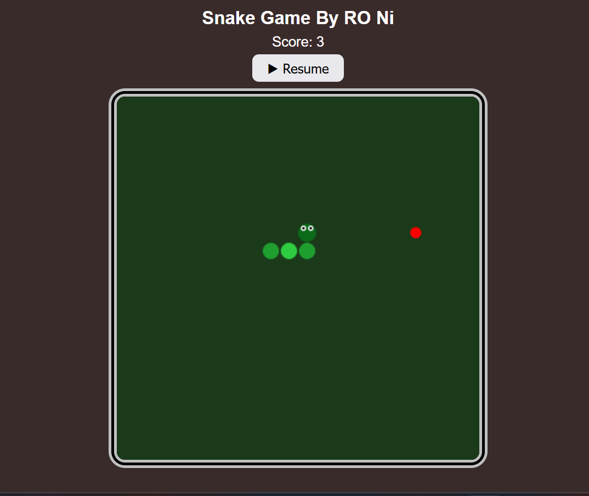

  <a href="https://dev-by-roni.github.io/snake-game-by-roni/">
    🎮 Play Live Demo
  </a>

# 🐍 Snake Game By RO Ni

A fun and interactive Snake Game built using HTML, CSS and JavaScript.
## 📸 Game Preview

  

## 🎮 Features
- Snake Movement
- Food Collection
- Real-time Score Tracking
- Pause & Resume
- Keyboard Controls
- Mobile Touch Controls
- Sound Effects
- Animated Food
- Game Over Detection

## 🛠️ Technologies Used
- HTML5
- CSS3
- JavaScript
- Canvas API

## 🎯 How to Play
- Use Arrow Keys to move the snake.
- Collect food to increase your score.
- Avoid hitting walls and yourself.
- Press Space to pause or resume.
- Use touch controls on mobile.

## 👨‍💻 Developer
Abdur Rahman Roni

GitHub: https://github.com/dev-by-roni
